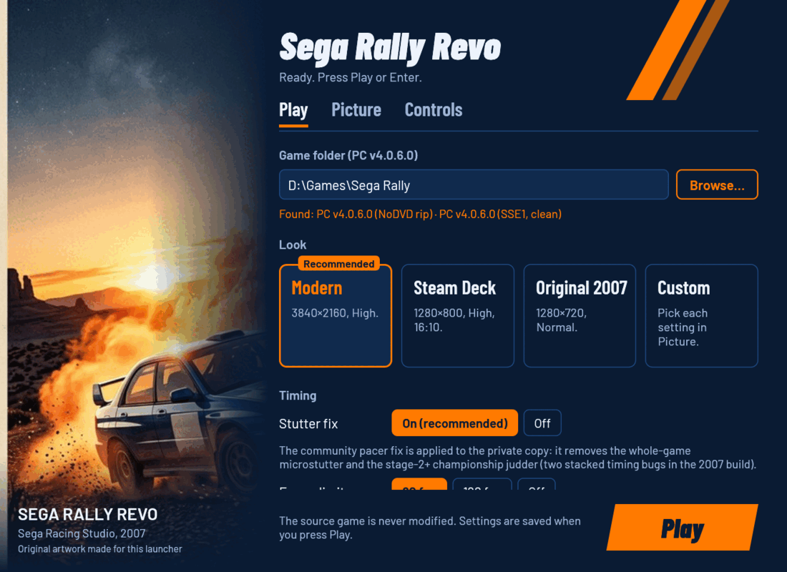
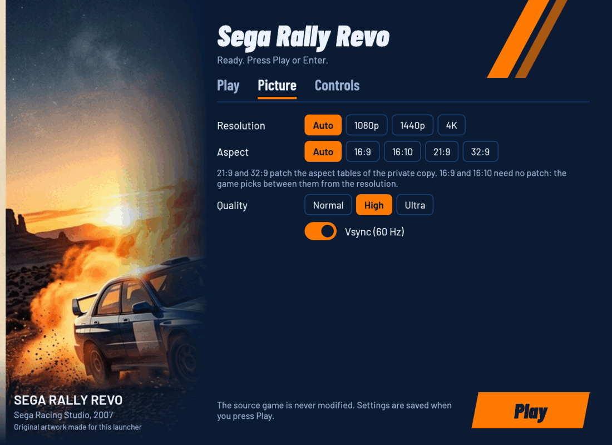
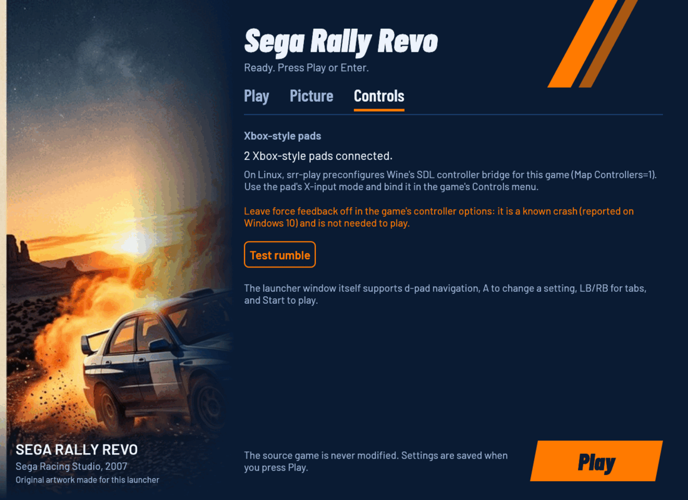

# Sega Rally Revo Launcher

Play your own PC copy of **Sega Rally Revo** (2007) on Windows 10/11 or on
Linux, at 4K, without the stutter. Point the launcher at the game folder and
press **Play**: it builds a private, fixed-up copy of the game and starts it.
Your installed game folder is never changed.

Built on [rea-launcher-sdk](https://github.com/akitaonrails/rea-launcher-sdk),
the shared kit of the rea launchers.



### See it running

[](https://new-uploads-akitaonrails.s3.us-east-2.amazonaws.com/2026/11/02/sega-rally-revo-launcher.mp4)

The AppImage on a Linux desktop (Hyprland, RTX 5090, 4K): Play in the
launcher, the game's own start-up, then a Safari race on a gamepad with
the stutter fix applied (2:49; the first-run loading wait is cut out).

## What it fixes

The 2007 PC release is a great rally game in a fragile package. Each row
below was a real hurdle on a modern machine; the launcher handles all of
them for you.

| Problem with a plain 2007 install | What the launcher does |
| --- | --- |
| Every race microstutters, and Championship stages after the first judder (two stacked timing bugs in the game) | Applies the community stutter fix (pacer patch) to the private copy |
| The game wants registry entries, a `config.ini` and a Documents folder layout made by the installer or its .NET settings tool, which misbehaves under Wine | Writes all of them itself, the way the original tool would; your controller bindings in `config.ini` are kept |
| Exclusive fullscreen crashes on multi-monitor and high-refresh Linux desktops | Runs the game inside an isolated Wine desktop at the chosen resolution |
| Uneven frame pacing | DXVK frame limit: 60 fps by default, 120 or off for high-refresh screens |
| Startup stalls on the logo videos under Wine | Switches the two logo videos off in the private copy |
| Ultra-wide monitors get a stretched picture | Picks the 21:9 or 32:9 aspect fix from the resolution (not yet checked on a real ultra-wide screen) |
| Windows 10/11 lack the DirectX 9 files the game was built with | One **Download** button fetches them from Microsoft into the private copy |
| DXVK picks the integrated GPU on hybrid laptops and desktops (black screen) | Pins the discrete GPU's Vulkan driver |
| Community fixes overwrite your install | Everything happens in a private copy; the source folder is only read |

## What you need

Your PC copy of the game, version **4.0.6.0** (the EN-FR-DE-ES-IT-PL
release). The launcher recognizes the game executables by exact SHA-256 and
refuses anything else instead of patching it blindly:

| Executable | SHA-256 | Used for |
| --- | --- | --- |
| `SEGA Rally_SSE1.exe` (clean) | `22655a54bad6932239ade58325703bd4b5a2020376737748026443fa5aadf76e` | the default; the stutter fix applies only to this build |
| `SEGA Rally.exe` (no-DVD build in common copies) | `ad84ecea6ac5e86e1f1a420f07595866429bba63e7c489b40661a8032ba391d7` | played when the stutter fix is off or unavailable |

Another build is refused with its SHA-256 and a link to report it
([test report](https://github.com/akitaonrails/rea-sega-rally-revo/issues/new?template=test-report.yml),
with `launcher.log` attached). The retail DVD's own `SEGA Rally.exe` is not
in the table yet: we have no verified hash for it.

## Install

Download the latest release from the
[Releases page](https://github.com/akitaonrails/rea-sega-rally-revo/releases).

**Linux (recommended): the AppImage.** It bundles Wine 11.20 and DXVK 3.1.1,
so nothing else needs to be installed:

```sh
chmod +x SRRLauncher-*-x86_64.AppImage
./SRRLauncher-*-x86_64.AppImage
```

**Windows: the zip.** Unzip it anywhere and run `SRRLauncher.exe`.

**Linux with your own Wine or Proton:** the zip also works. Run
`linux/srr-play` from it (see [linux/README.md](linux/README.md)).

**Steam / Steam Deck:** add the AppImage as a non-Steam game. To use Steam's
Proton instead, add `SRRLauncher.exe` as a non-Steam game and force a Proton
version; the frame limit then goes through Proton's own DXVK.

## First run

1. Start the launcher. On the **Play** tab, click **Browse…** and choose the
   folder that holds `SEGA Rally.exe` / `SEGA Rally_SSE1.exe`. Under Wine your
   Linux files are on drive `Z:`, e.g. `Z:\home\you\Games\Sega Rally`.
2. Pick a **Look** (Modern is right for most screens) and leave the stutter
   fix on.
3. Press **Play** (or Enter, or Start on the pad). The first launch copies the
   game (about 4.2 GB) into the private folder; later launches copy only
   files that changed.

On **Windows**, press **Download** under *Microsoft DirectX 9 files* on the
Play tab once (100 MB from Microsoft): Windows 10 and 11 don't include the
DirectX 9 extension files the game was built with. On Linux the game runs
without them; the button is there if the game crashes at the main menu.
Nothing is downloaded unless you press it.

## The settings window

### Play

Game folder, the Look presets, the stutter fix, the frame limit, the menu
language and the DirectX 9 download (screenshot at the top).

| Look | Resolution | Quality | Vsync |
| --- | --- | --- | --- |
| **Modern** (default) | your screen | High | on |
| **Steam Deck** (default on a Deck) | 1280×800 | High | on |
| **Original 2007** | 1280×720 | Normal | on |
| **Custom** | whatever you set on the Picture tab | | |

### Picture



Resolution (with the size and aspect the game will run at), quality and
vsync. Changing any of them turns the Look into Custom. The screenshot
predates v0.2: the aspect row is gone, the aspect follows the resolution.

### Controls



Shows the connected Xbox-style (XInput) pads and has a **Test rumble**
button, which only checks that the pad accepts rumble. The game uses its own
native gamepad support: nothing is remapped to the keyboard. Bind the pad in
the game's own Controls menu. Keep the game's force feedback **off**; it is a
known crash and adds nothing.

The window itself works with a pad: d-pad to move, **A** to change the
focused setting, **LB/RB** to switch tabs, **Start** to play.

## All options

Every setting is in the window, in `launcher.cfg`, and on the command line
(one table in the code, `config::OPTIONS`, generates all three).

| Setting | Values | Default | `launcher.cfg` key | Command line |
| --- | --- | --- | --- | --- |
| Game folder | a folder | (asked on first run) | `game` | `--game <folder>` |
| Private copy | a folder outside the game folder | `%LOCALAPPDATA%\SRRLauncher\SegaRally` | `runtime` | `--runtime <folder>` |
| Look | modern, steam-deck, original, custom | the recommended look | `look` | `--look original` |
| Resolution | auto, your screen, 1080p, 1440p, 4K, or any `WxH` | auto (screen size, or 1920×1080) | `resolution` | `--resolution 3840x2160` |
| Quality | normal, high, ultra | high | `quality` | `--quality high` |
| Vsync | on, off | on | `vsync` | `--vsync on` |
| Stutter fix | on, off | on | `stutter_fix` | `--stutter-fix on` |
| Frame limit | 60, 120, off | 60 | `frame_limit` | `--frame-limit 60` |
| Menu language | English, French, German, Spanish, Italian, Polish | English | `language` | `--language French` |
| DirectX 9 files | Download / Remove button | not downloaded | — | `--download-directx` |

Notes:

- **Unset keys** keep the game's own value: once `config.ini` exists, the
  launcher writes only the keys of options set in `launcher.cfg`, so a
  choice made in the game's menu stays. The window saves every value when
  you press Play (auto resolution as the size it stands for).
- **Look on the command line** sets that look's resolution, quality and
  vsync for one run; other options on the same command line still win.
- **Aspect** follows the resolution: 16:9 and 16:10 are the game's own;
  ultra-wide sizes (21:9 such as 2560×1080 or 3440×1440, 32:9 such as
  5120×1440) get the aspect fix in the private copy.
- **Quality** maps to the game's ten per-feature sliders (scale 0–3).
  *High* is the configuration proven on the reference 4K setup; *Normal*
  sets every slider to 2 and *Ultra* every slider to 3.
- **Frame limit** runs through DXVK, so it applies on Linux, Wine and
  Proton. On native Windows the game has no DXVK and follows vsync instead;
  the buttons are disabled there.
- **Stutter fix** needs the clean `SEGA Rally_SSE1.exe`. Without it the game
  runs unpatched from `SEGA Rally.exe`; your saved choice is kept for later.
- Keys of earlier versions keep working: `frame-limit` and `stutter-fix`
  are read (the window saves the new names), an `aspect` line is ignored.
- The game always runs fullscreen. Under Wine that fullscreen is the isolated
  Wine desktop, which is a window of the chosen size on your desktop.
- Championship mode caps itself at 62.5 fps inside the game; that cap cannot
  be changed from outside.

### Command line

```text
SRRLauncher [options]

  --game <folder>                                          Game folder
  --runtime <folder>                                       Private copy
  --look modern|steam-deck|original|custom                 Look
  --resolution <WxH>                                       Resolution
  --quality normal|high|ultra                              Quality
  --vsync on|off                                           Vsync
  --frame-limit 60|120|off                                 Frame limit
  --stutter-fix on|off                                     Stutter fix
  --language English|French|German|Spanish|Italian|Polish  Language
  --check             check the game folder and exit (exit code 1 if it cannot play)
  --setup             prepare the private copy and the game's settings, without playing
  --download-directx  download Microsoft's DirectX 9 files into the private copy, then exit
  --no-window         play with the saved settings, no launcher window
  --settings          only show the settings window
  --linux             running under srr-play or the AppImage: install DXVK into the copy
  --help              show this help

Options override launcher.cfg for one run; only --game is remembered.
```

Without options the settings window opens. Options on the command line
override `launcher.cfg` for that run only; only the game folder is saved
(the window's **Play** button saves everything). Invalid values are
rejected with a message naming what the option takes. `--help`, `--check`
and errors print to the terminal you started the launcher from (a message
box when there is none); `--check` exits with 1 when the folder cannot be
played. The game is fully playable without the window:
`SRRLauncher --no-window` (or `srr-play --play`) uses the saved settings.

The AppImage and `srr-play` add their own commands:

```sh
./SRRLauncher-x86_64.AppImage          # settings window, then play
./SRRLauncher-x86_64.AppImage --play   # play with saved settings, no window
./SRRLauncher-x86_64.AppImage stop     # end the game
./SRRLauncher-x86_64.AppImage status   # running or idle
```

## Where things are

| What | Windows | Linux (AppImage / `srr-play`) |
| --- | --- | --- |
| Launcher settings | `%LOCALAPPDATA%\SRRLauncher\launcher.cfg` (or `launcher.cfg` next to the exe) | `~/.local/share/srr-launcher/prefix/drive_c/users/<you>/AppData/Local/SRRLauncher/launcher.cfg` |
| Private game copy | `%LOCALAPPDATA%\SRRLauncher\SegaRally` | the same path inside that Wine prefix |
| Saves and `config.ini` | `Documents\SEGA Rally\Saved Games` | `Documents` inside the prefix, which Wine usually links to your `~/Documents` |
| DirectX 9 files (after Download) | `%LOCALAPPDATA%\SRRLauncher\directx` | the same path inside that Wine prefix |
| Logs | `%LOCALAPPDATA%\SRRLauncher\launcher.log` | the same, plus `~/.config/srr-launcher/play.log` and `settings.log` |

Saves (`SEGA Rally.dat`, `SR_RANKTABLES.DAT`) are created only when missing
and never deleted. An existing `config.ini` keeps its `[Audio]` and
`[GameController]` sections untouched; only the `[Graphics]` keys of the
options set in `launcher.cfg` are updated.

## Troubleshooting

- **"This launcher supports the Sega Rally Revo PC v4.0.6.0 build"**: the
  executables are not the supported ones. The message shows the SHA-256 the
  launcher found; please report it with the test-report form so the
  edition can be added.
- **Black screen while the game seems to run** (hybrid-GPU Linux): check the
  `GPU:` line `srr-play` prints at startup; it should name the discrete GPU's
  Vulkan driver.
- **The game does not start on Windows ("d3dx9_… .dll was not found") or
  crashes at the main menu**: press **Download** under *Microsoft DirectX 9
  files* on the Play tab (or run `SRRLauncher --download-directx`), then
  Play again.
- **The pad does nothing in the game**: switch the pad to X-input mode, then
  bind it in the game's Controls menu.

## Uninstall

Your game folder was never modified, so there is nothing to undo there.

1. **Back up your saves first** if you want to keep them:
   `Documents\SEGA Rally\Saved Games` (and `Public Documents\SEGA
   Rally\Shared Data` for rank tables and ghosts). On Linux these live in
   the Wine prefix's `drive_c/users/<you>/Documents` (often linked to your
   own `~/Documents`) and `drive_c/users/Public/Documents`.
2. Windows: delete `%LOCALAPPDATA%\SRRLauncher` (settings, private copy,
   DirectX files, log) and the launcher's folder. The registry key
   `HKLM\SOFTWARE\WOW6432Node\Sega\SEGA Rally` (or its VirtualStore twin
   under HKCU) can go too.
3. Linux: delete the AppImage or zip, `~/.config/srr-launcher`, and
   `~/.local/share/srr-launcher` — **this holds the Wine prefix, so your
   saves are inside it unless Wine linked Documents to your home folder.**
   Back them up first.

## Building

```sh
cargo fmt --all --check
cargo test --workspace                                 # host tests, incl. the headless window tests
for t in linux/tests/*.sh; do sh "$t"; done            # Linux helper tests
cargo clippy --release --target i686-pc-windows-gnu --workspace -- -D warnings
cargo deny check
cargo build --release --locked --target i686-pc-windows-gnu   # needs i686 mingw-w64 and lld
sdk/scripts/wine-test --locked --workspace             # the Windows-target tests under Wine, headless
sh packaging/package.sh <version> dist target/i686-pc-windows-gnu/release   # zip + AppImage
```

`crates/srr-launcher/tests/snapshots/` holds golden snapshots of `--help`,
the `launcher.cfg` template and what each look and a few option
combinations write. A changed snapshot must match an intended change;
regenerate with `SRR_UPDATE_SNAPSHOTS=1 cargo test --test snapshots` and
review every diff. The real game is only used by the env-gated
`SRR_GAME_DIR=… cargo test real_game -- --ignored`.

CI (`.github/workflows/build.yml`, the SDK's reusable `launcher-ci` and
`launcher-release`) runs all of this on every push, including the
Windows-target tests under Wine, checks that every import of the built exe
resolves, uploads the Windows zip and the AppImage, and publishes both as a
GitHub Release for `v*` tags. `mirror.yml` copies the pinned DXVK into the
`thirdparty` release, the pins' fallback.

Further reading: [docs/RESEARCH.md](docs/RESEARCH.md) (the fixes, the
community work and the evidence behind them) and
[docs/RUNTIME_NOTES.md](docs/RUNTIME_NOTES.md) (what was verified on real
hardware, and what was not).

## Contributing

- **Sega Rally Revo problems** (the game, its editions, its settings,
  `srr-play`'s game choices, this README): issues and pull requests here.
- **Shared code** — the private-copy engine, `launcher.cfg`/INI editing,
  the settings window's widgets and theme, `rea-play.sh`, the packaging
  scripts, the CI workflows, anything under `sdk/` — belongs to
  [rea-launcher-sdk](https://github.com/akitaonrails/rea-launcher-sdk):
  open the issue or pull request there. If a fix would touch a
  `rea_launcher*` crate or a file in `sdk/`, it is shared code.
- Never patch `sdk/` (it is vendored by the SDK's `scripts/sdk-sync` and CI
  fails on drift) and never copy SDK code into this repository.
- Test reports are welcome: use the
  [test-report form](https://github.com/akitaonrails/rea-sega-rally-revo/issues/new?template=test-report.yml).

## Credits

- **stuken** — [SegaRallyRevoStutterFix](https://github.com/stuken/SegaRallyRevoStutterFix),
  the stutter fix this launcher applies (reimplemented in Rust).
- **DXVK** (Philip Rebohle and contributors) — Direct3D 9 on Vulkan for
  Linux.
- **Wine** and **Kron4ek's** Wine builds — the AppImage's Wine.
- **AppImage** (appimagetool, type2 runtime).
- PCGamingWiki and WSGF — the aspect-table technique; the Lutris installer
  and NeoGAF's 2016 analysis of the frame pacing.
- The Barlow typeface (Jeremy Tribby), SIL OFL.
- [rea-launcher-sdk](https://github.com/akitaonrails/rea-launcher-sdk).

See [THIRD_PARTY.md](THIRD_PARTY.md) for licences.

## Legal

Sega Rally Revo © SEGA. This is a fan-made compatibility tool, not affiliated
with or endorsed by SEGA. It ships no game files; it only writes a private
copy of the game you own plus its own settings. Code: MIT OR Apache-2.0. See
[THIRD_PARTY.md](THIRD_PARTY.md) for everything bundled.
