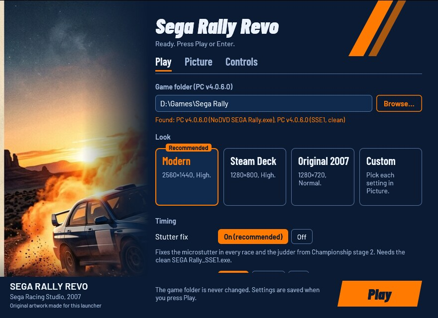
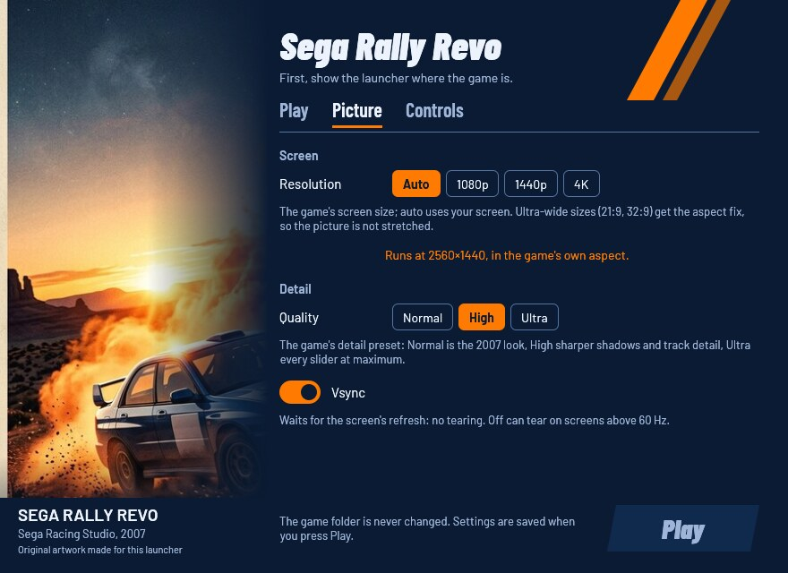
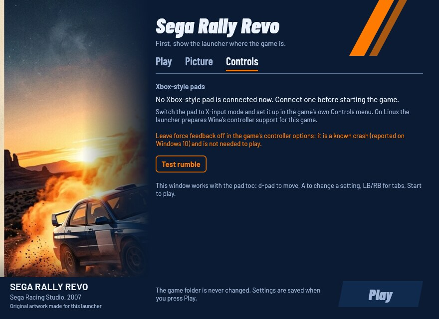

# Sega Rally Revo Launcher

Play your own PC copy of **Sega Rally Revo** (2007) on Windows 10/11, the
Steam Deck and Linux (the AppImage, Proton or Wine), at 4K and without the
stutter. Point the launcher at your game folder and press **Play**:
everything the game needs is bundled and set up, with no patchers,
winetricks, DLL overrides or registry edits by hand. Your game folder is
only read, never changed: the launcher plays from a private copy.

This project contains no game files: you need your own copy of the game.

> Played end to end with the Linux AppImage on a 4K desktop, menus and a
> full race with a gamepad. Native Windows 10/11, the Steam Deck, Steam's
> Proton and ultra-wide screens are not tested yet: reports are welcome
> ([bug-report form](https://github.com/akitaonrails/rea-sega-rally-revo/issues/new?template=bug-report.yml)).

[](https://new-uploads-akitaonrails.s3.us-east-2.amazonaws.com/2026/11/02/sega-rally-revo-launcher.mp4)

*The AppImage on a Linux desktop (Hyprland, RTX 5090, 4K): Play in the
launcher, the game's own start-up, then a Safari race on a gamepad with
the stutter fix on. Click to watch (2:49, with sound; the first-run
loading wait is cut out).*

## Problems this launcher solves

| Problem | What the launcher does |
| --- | --- |
| The game wants registry entries, a `config.ini` and a Documents folder made by its installer or its settings tool, which misbehaves under Wine | Writes all of them itself, the way the original tool would, and keeps your controller bindings |
| Exclusive fullscreen crashes on multi-monitor and high-refresh Linux desktops | Runs the game inside its own Wine desktop at the resolution you chose |
| On hybrid-GPU laptops and desktops the game renders on the integrated GPU and shows a black screen | Makes the game use the discrete GPU |
| Startup stalls on the logo videos under Wine | Turns the two logo videos off in the private copy |
| Every race microstutters, and Championship stages after the first judder | Applies the launcher's stutter fix (a clean-room rewrite after stuken's analysis) to the private copy |
| Frame pacing is uneven | Caps the frame rate at 60 fps, or 120 or off for high-refresh screens (Linux, Wine and Proton) |
| Community fixes overwrite your install | Everything happens in a private copy; your game folder is only read |

## Screenshots

| Play | Picture | Controls |
| --- | --- | --- |
|  |  |  |

## What you need

Your PC copy of Sega Rally Revo, version **4.0.6.0** (the English, French,
German, Spanish, Italian and Polish release). The launcher plays the clean
`SEGA Rally_SSE1.exe` (the stutter fix needs this one) or the no-DVD
`SEGA Rally.exe` found in common copies, as they are: it can't and won't
remove a disc check or any other DRM.

The launcher checks the exact game files before it changes anything. A
version it doesn't know is refused with a code (its SHA-256) and a link to
report it on the
[unknown-edition form](https://github.com/akitaonrails/rea-sega-rally-revo/issues/new?template=unknown-edition.yml).
Report the code, never the game files. The retail DVD's own
`SEGA Rally.exe` isn't known yet.

<details>
<summary>The supported files, to check by hand</summary>

| File | SHA-256 |
| --- | --- |
| `SEGA Rally_SSE1.exe` (clean) | `22655a54bad6932239ade58325703bd4b5a2020376737748026443fa5aadf76e` |
| `SEGA Rally.exe` (no-DVD) | `ad84ecea6ac5e86e1f1a420f07595866429bba63e7c489b40661a8032ba391d7` |

</details>

## Download and install

Download from the [latest release](https://github.com/akitaonrails/rea-sega-rally-revo/releases/latest):
`SRRLauncher-<version>.zip` (Windows, and Linux with your own Wine) or
`SRRLauncher-<version>-x86_64.AppImage` (Linux, Steam Deck).

### Windows

1. Unzip `SRRLauncher-<version>.zip` anywhere outside the game folder.
2. Run `SRRLauncher.exe`.

The launcher is not signed, so the first start from a downloaded zip may
show "Windows protected your PC": click *More info*, then *Run anyway*.

### Steam Deck

1. In Desktop Mode, keep the AppImage somewhere in your home folder and
   make it executable (right-click → Properties → Permissions).
2. In Steam, *Add a Non-Steam Game* and pick the AppImage.
3. Back in Game Mode, start it from your library. The **Steam Deck** look
   is recommended on a Deck.

Game Mode is not tested yet.

### Linux: AppImage

```sh
chmod +x SRRLauncher-<version>-x86_64.AppImage
./SRRLauncher-<version>-x86_64.AppImage
```

It brings its own Wine and DXVK, so nothing else needs installing. Its
Wine prefix is `~/.local/share/srr-launcher/prefix`, and your Linux files
are on drive `Z:` inside it.

### Linux: Steam (Proton)

Add `SRRLauncher.exe` from the zip as a non-Steam game and force a Proton
version in its Properties → Compatibility. Proton then uses its own DXVK
(the frame limit still applies) and the GPU choice is left to Steam.

### Linux: your own Wine

Run `linux/srr-play` from the zip:

```sh
srr-play            # settings window, then play
srr-play --play     # play with the saved settings, no window
srr-play stop       # end the game
srr-play status     # running or idle
```

The AppImage takes the same commands. Variables and a distrobox setup are
in [linux/README.md](linux/README.md).

## First run

1. Start the launcher. On the **Play** tab, click **Browse…** and choose the
   folder that holds `SEGA Rally.exe` or `SEGA Rally_SSE1.exe`. Under Wine
   your Linux files are on drive `Z:`, e.g. `Z:\home\you\Games\Sega Rally`.
2. Pick a look (**Modern** is recommended, **Steam Deck** on a Deck) and
   leave the stutter fix on.
3. Press **Play** (or Enter, or Start on a pad). The first launch copies the
   game (about 4.2 GB) into the private copy; later launches copy only the
   files that changed.

On Windows, press **Download** under *Microsoft DirectX 9 files* on the
Play tab once. Windows 10 and 11 don't include the DirectX 9 files the game
was built with, and their licence doesn't let the launcher ship them, so
this fetches
Microsoft's own package (100 MB) and puts the files in the private copy.
On Linux the game runs without them. Nothing downloads unless you press
the button.

## The settings window

**Play** has the game folder, the looks, the stutter fix, the frame limit,
the menu language and the DirectX 9 download. **Picture** has the
resolution (with the size and aspect the game will run at), the quality,
vsync and the display mode; changing the first three turns the look into
**Custom**. **Controls** shows the connected Xbox-style pads, the
pad-rumble switch, a **Test rumble** button, which only checks that the
pad accepts rumble, and your keyboard keys.

| Look | Resolution | Quality | Vsync | When to pick it |
| --- | --- | --- | --- | --- |
| **Original 2007** | 1280×720 | Normal | on | the game as it looked in 2007 |
| **Modern** | your screen | High | on | most screens (recommended) |
| **Steam Deck** | 1280×800 | High | on | the Deck (recommended there) |
| **Custom** | what you set on the Picture tab | | | |

The first run picks the recommended look. The window works with a pad
(d-pad to move, **A** to change a setting, **LB/RB** for tabs, **Start**
to play) and with the keyboard alone (Tab to move, Space to change a
setting, Ctrl+Tab for tabs, Enter to play). A greyed-out control says why when you point
at it.

## Gamepad

The game has its own gamepad support, and the launcher remaps nothing to
the keyboard. Switch the pad to X-input mode and bind it once in the
game's own Controls menu. On Linux the launcher sets up Wine's controller
support for this game.

The game vibrates the pad in races — that is its own default. The
**pad rumble** switch writes the game's vibration setting (off if the
rumble annoys you); your pad and its bindings are kept. Windows 10 crash
reports exist for the 2007 settings tool's force-feedback box, so turn
rumble off if the game crashes with it on.

## Keyboard

You can also drive with the keyboard. These are the game's keys, from its
manual:

| Key | Action |
| --- | --- |
| A | Accelerate |
| Z | Brake / reverse |
| , (comma) | Steer left |
| . (period) | Steer right |
| Space | Handbrake |
| S | Shift up |
| X | Shift down |
| Left Ctrl | Change camera |
| Tab | Show or hide driver names |
| O / P | Time Trial: class up / class down |

The game has no menu to change these keys, and the settings tool that
came with the game only sets up DirectInput pads and wheels. The launcher
can change them: on the Controls tab, **Keyboard keys** takes
`action=key` pairs separated by commas, for example

```
keys = accelerate=up, brake=down, steer_left=left, steer_right=right
```

Actions: `accelerate`, `brake`, `steer_left`, `steer_right`,
`handbrake`, `shift_up`, `shift_down`, `camera`, `driver_names`,
`class_up`, `class_down`. Keys are named by where they sit on a US
keyboard (the game reads key positions, not letters): `a`–`z`, `0`–`9`,
`up`, `down`, `left`, `right`, `space`, `tab`, `backspace`,
`left_shift`, `right_shift`, `left_ctrl`, `right_ctrl`, `left_alt`,
`right_alt`, `comma`, `period`, `slash`, `semicolon`, `apostrophe`,
`grave`, `minus`, `equals`, `left_bracket`, `right_bracket`,
`backslash`, `insert`, `delete`, `home`, `end`, `page_up`, `page_down`,
`numpad_0`–`numpad_9`, `numpad_plus`, `numpad_minus`,
`numpad_multiply`, `numpad_divide`, `numpad_period`, `numpad_enter`.
Escape, Enter and the F keys stay with the game's menus. An action you
don't name keeps its key from the table above; two actions can't share a
key. The window shows the keys you will get as you type.

This patches the launcher's private copy of the game (your game folder
stays untouched): the game asks "is A down?" and gets the answer for the
key you chose. Keys you didn't move work as before, so the menus are
unchanged. It works with the clean `SEGA Rally_SSE1.exe` and the
full rip's `SEGA Rally.exe`; a copy already patched with the community
stutter fix runs with the manual's keys.

## Options

Every option has the same name in the window, in `launcher.cfg` (with
underscores) and on the command line (with hyphens). Where `launcher.cfg`
is: [Where things live](#where-things-live). The first run writes a
commented `launcher.cfg` listing every option.

| `launcher.cfg` / flag | In the window | Values | Unset | What it changes |
| --- | --- | --- | --- | --- |
| `game` / `--game` | Play: Game folder | a folder | asked on the first run | The folder with `SEGA Rally.exe` or `SEGA Rally_SSE1.exe`. It is only read, never changed. |
| `runtime` / `--runtime` | — (file and flag only) | a folder outside the game folder | `%LOCALAPPDATA%\SRRLauncher\SegaRally` | Where the launcher keeps its private copy of the game. |
| `look` / `--look` | Play: Look | `modern`, `steam-deck`, `original`, `custom` | the recommended look | A ready-made picture. On the command line it sets that look's resolution, quality and vsync for one run; other options still win. |
| `stutter_fix` / `--stutter-fix` | Play: Stutter fix | `on`, `off` | on | Fixes the microstutter in every race and the judder from Championship stage 2. Needs the clean `SEGA Rally_SSE1.exe`; without it the game runs from `SEGA Rally.exe` and your choice is kept for later. |
| `rumble` / `--rumble` | Controls: Pad rumble | `on`, `off` | the game's (on) | Whether the game vibrates the pad in races. Writes the game's own vibration switch inside the controller string; the pad, its GUID and bindings are kept as they are. |
| `frame_limit` / `--frame-limit` | Play: Frame limit | `60`, `120`, `off` | 60 | The highest frame rate under Linux, Wine or Proton (through DXVK). On native Windows the game follows vsync and the control is greyed out. |
| `language` / `--language` | Play: Language | `English`, `French`, `German`, `Spanish`, `Italian`, `Polish` | the game's (English when it has none) | The language of the game's menus. |
| `resolution` / `--resolution` | Picture: Resolution | `auto` or `WIDTHxHEIGHT` | the game's (your screen on a first run) | The game's screen size; `auto` uses your screen. Ultra-wide sizes (21:9 such as 3440×1440, 32:9 such as 5120×1440) get the aspect fix so the picture isn't stretched. |
| `quality` / `--quality` | Picture: Quality | `normal`, `high`, `ultra` | the game's (High on a first run) | The game's detail preset: Normal is the 2007 look, High sharper shadows and track detail, Ultra every slider at maximum. |
| `display_mode` / `--display-mode` | Picture: Display mode | `fullscreen`, `borderless` | fullscreen | Fullscreen is the game's own: it switches the screen to the resolution. Borderless puts the game in a window without borders that covers the whole screen: no display-mode switch, quick Alt+Tab, and a smaller resolution is scaled up to the screen. Under Linux the game's Wine desktop then covers the screen too. Patches the private copy (the clean `SEGA Rally_SSE1.exe` or the full rip's `SEGA Rally.exe`). |
| `keys` / `--keys` | Controls: Keyboard keys | `action=key` pairs, e.g. `accelerate=up, brake=down` | the manual's keys | Your own keyboard keys: see [Keyboard](#keyboard). |
| `vsync` / `--vsync` | Picture: Vsync | `on`, `off` | the game's (on on a first run) | Waits for the screen's refresh: no tearing. Off can tear on screens above 60 Hz. |

An unset option keeps the game's own value: once the game has its
`config.ini`, the launcher writes only the options set in `launcher.cfg`,
so a choice made in the game's menu stays. The window saves every value
when you press **Play**.

Any option on the command line skips the window and plays. Options
override `launcher.cfg` for that run only; only `--game` is remembered.
Wrong values are refused with a message saying what the option takes.
Older settings files keep working: `frame-limit` and `stutter-fix` are
still read, and old `aspect` and `fullscreen` lines are ignored.

The launcher's switches:

- `--settings`: only show the settings window.
- `--no-window`: play with the saved settings, no window.
- `--check`: check the game folder and exit (exit code 1 if it can't play).
- `--setup`: prepare the private copy and the game's settings without
  playing.
- `--download-directx`: download Microsoft's DirectX 9 files, then exit.
  With the settings window open it exits with code 5 and tells you to use
  the window's Download button.
- `--check`, `--setup` and `--download-directx` don't run while the
  settings window is open or the game runs: they say so and exit with
  code 5.
- `--linux`: set by `srr-play` and the AppImage.
- `--help`: list every option.

`--help`, `--check` and errors print to the terminal you started the
launcher from, or show a message box when there is none. Exit codes for
scripts: after a game, the game's own exit code; 1 for an error or when
`--check` found a problem; 2 for a command line the launcher can't read
(an unknown option or a bad value: it prints the problem and `--help`'s
list, and shows no message box when you started it from a terminal); with
`--settings`, 0 Play pressed, 3 closed without Play, 4 no window possible;
5 the game is already running (another launcher is running it, or it
is still running from the launcher's copy), or `--check`, `--setup` or
`--download-directx` found the settings window open.

The game runs fullscreen, or borderless with `display_mode = borderless`.
Under Wine it runs in its own Wine desktop: a window of the chosen size on
your desktop, or one covering the screen in borderless mode.

## Where things live

| What | Windows | Linux (AppImage, `srr-play`) |
| --- | --- | --- |
| Settings (`launcher.cfg`) and log (`launcher.log`) | `%LOCALAPPDATA%\SRRLauncher\` | in the prefix, `drive_c/users/<you>/AppData/Local/SRRLauncher/` |
| The launcher's copy of the game | `%LOCALAPPDATA%\SRRLauncher\SegaRally` | the same path inside the prefix |
| Your saves and the game's `config.ini` | `Documents\SEGA Rally\Saved Games`; rank tables and ghosts in `Public Documents\SEGA Rally\Shared Data` | the prefix's `drive_c/users/<you>/Documents` (Wine often links it to your `~/Documents`) and `drive_c/users/Public/Documents` |
| DirectX 9 files (after **Download**) | `%LOCALAPPDATA%\SRRLauncher\directx` | the same path inside the prefix |
| Wine prefix | — | `~/.local/share/srr-launcher/prefix` |
| `srr-play`'s logs and lock | — | `~/.config/srr-launcher` |

A `launcher.cfg` next to `SRRLauncher.exe` is used instead of the one in
`%LOCALAPPDATA%` (a portable setup). Under Steam's Proton everything is in
Steam's `compatdata/<appid>/pfx` prefix.

The launcher creates the saves only when they are missing and never
deletes them. In an existing `config.ini` it leaves the audio and
controller settings alone.

Registry entries the launcher writes:

| Entry | Where | Why |
| --- | --- | --- |
| `HKLM\SOFTWARE\WOW6432Node\Sega\SEGA Rally` (or its VirtualStore copy under HKCU) | Windows, and the Wine prefix | the game's install values, the way its installer writes them |
| `HKCU\Software\Microsoft\DirectX\UserGpuPreferences`, a value named after the private copy's game exe (`…\SRRLauncher\SegaRally\SEGA Rally_SSE1.exe` or `SEGA Rally.exe`) = `GpuPreference=2;` | Windows only, only when you haven't chosen a GPU for it | the game uses the high-performance GPU |
| `HKLM\System\CurrentControlSet\Services\winebus` (`DisableHidraw`, `DisableInput`, `Enable SDL`, `Map Controllers`, each only when missing) | the Wine prefix | pads reach the game once, through Wine's SDL bridge |
| `HKCU\Software\Wine\X11 Driver` `UseEGL = N` (only when missing) | the Wine prefix | the settings window draws through OpenGL GLX |
| `HKCU\Software\Wine\AppDefaults\<game exe>\DllOverrides`, and the launcher's record of them under `HKCU\Software\rea-launcher\DllOverrides\<game exe>` | the Wine prefix | the bundled DXVK `d3d9.dll` is loaded |

## Troubleshooting

- **"This launcher supports the Sega Rally Revo PC v4.0.6.0 build"**: your
  game files are not a version the launcher knows. The message shows a
  code (SHA-256); report it on the
  [unknown-edition form](https://github.com/akitaonrails/rea-sega-rally-revo/issues/new?template=unknown-edition.yml)
  so the version can be added.
- **The game doesn't start on Windows ("d3dx9_… .dll was not found") or
  crashes at the main menu**: press **Download** under *Microsoft DirectX 9
  files* on the Play tab (or run `SRRLauncher --download-directx`), then
  **Play** again.
- **Black screen while the game seems to run** (Linux, hybrid GPU): check
  the `GPU:` line `srr-play` prints when it starts; it should name the
  discrete GPU.
- **The pad does nothing in the game**: switch the pad to X-input mode,
  then bind it in the game's Controls menu.
- **"Sega Rally Revo is already running from this launcher"**: the game
  from an earlier start is still running. Quit it first.
- **Anything else**: run `SRRLauncher --check`, then open an issue with the
  [bug-report form](https://github.com/akitaonrails/rea-sega-rally-revo/issues/new?template=bug-report.yml)
  and attach `launcher.log` (remove personal paths). Never attach game
  files.

## Known limitations

- Championship mode caps itself at 62.5 fps inside the game; the launcher
  can't change that.
- On native Windows the frame limit doesn't apply (no DXVK); vsync sets
  the pace.
- Not tested yet: native Windows 10/11 (including whether the game needs
  the DirectX 9 download), the Steam Deck in Game Mode, Steam's Proton
  running `SRRLauncher.exe`, the ultra-wide aspect fix on a real 21:9
  or 32:9 screen, borderless mode on native Windows (tested under Wine
  and DXVK), and changed keys with a pad connected at the same time. See [docs/RUNTIME_NOTES.md](docs/RUNTIME_NOTES.md).

## Uninstall

1. **Back up your saves first**: `Documents\SEGA Rally\Saved Games` and
   `Public Documents\SEGA Rally\Shared Data` on Windows. On Linux they are
   in the Wine prefix (`drive_c/users/<you>/Documents`, often linked to
   your own `~/Documents`, and `drive_c/users/Public/Documents`), and step
   4 deletes the prefix.
2. Delete the launcher's folder (or the AppImage).
3. Windows: delete `%LOCALAPPDATA%\SRRLauncher` (settings, log, the private
   copy of about 4.2 GB, the DirectX 9 files). The registry key
   `HKLM\SOFTWARE\WOW6432Node\Sega\SEGA Rally` (or its VirtualStore copy
   under HKCU) can go too, unless you still play the game without the
   launcher. In `HKCU\Software\Microsoft\DirectX\UserGpuPreferences`,
   delete the value whose name ends in `SRRLauncher\SegaRally\SEGA
   Rally_SSE1.exe` or `SEGA Rally.exe` (Settings → System → Display →
   Graphics lists it too).
4. Linux: after copying the saves out, delete
   `~/.local/share/srr-launcher` (the Wine prefix, with the private copy)
   and `~/.config/srr-launcher`. With Proton, removing the Steam shortcut
   offers to delete its prefix, saves included.

Your game folder was never changed, so there is nothing to undo there.

## For developers

Rust (edition 2024), MinGW-w64 for i686 with lld (GNU ld 2.47 mis-links
the Windows imports; see `.cargo/config.toml`), Wine for the
Windows-target tests and `cargo-deny`; the `gaming` distrobox has them
all.

```sh
cargo fmt --all --check
cargo test --workspace --locked                        # host tests, the window headless
for t in linux/tests/*.sh; do sh "$t"; done            # Linux helper tests
cargo clippy --release --target i686-pc-windows-gnu --workspace -- -D warnings
cargo deny check
cargo build --release --locked --target i686-pc-windows-gnu
sdk/packaging/check-imports.sh target/i686-pc-windows-gnu/release/SRRLauncher.exe
sdk/scripts/wine-test --locked --workspace             # Windows-target tests under Wine, headless
sh <sdk>/scripts/sdk-sync --check .                    # sdk/ matches the pinned SDK tag
sh packaging/package.sh <version> dist target/i686-pc-windows-gnu/release   # zip + AppImage
```

- Moving to a new SDK: `sdk/scripts/sdk-bump vX.Y.Z` (Cargo tags, `sdk/`,
  workflow pins; prints the Migration notes), following
  `sdk/docs/playbooks/sdk-change.md`. A weekly workflow
  (`sdk-update.yml`) opens that pull request.
- Freeing disk space after a release: `sdk/scripts/clean` (dry run), then
  `sdk/scripts/clean --yes`.
- Golden snapshots: `crates/srr-launcher/tests/snapshots/` holds `--help`,
  the `launcher.cfg` template and what each look and a few option
  combinations write. A changed snapshot must match an intended change;
  regenerate with `SRR_UPDATE_SNAPSHOTS=1 cargo test --test snapshots` and
  review every diff.
- The real game is used only by the env-gated, read-only
  `SRR_GAME_DIR=<folder> cargo test real_game -- --ignored`.
- Packaging and CI: DXVK and the AppImage tools are fetched at package time
  from pinned URLs and SHA-256 (`packaging/third-party.txt`,
  `sdk/packaging/appimage/tools.pins`). GitHub Actions (the SDK's reusable
  `launcher-ci` and `launcher-release`) run the checks above, build the
  zip and the AppImage, and a `v*` tag publishes the release; `mirror.yml`
  copies the pinned DXVK into the `thirdparty` release, the pins' fallback.
- `srr-play` (`linux/`) is a short configuration of the SDK's
  `rea-play.sh`: a private prefix; Wine's SDL controller bridge for this
  game (`Map Controllers=1`, `Enable SDL=1`, `DisableHidraw=1`,
  `DisableInput=1`), seeded once per prefix before Wine starts, existing
  values kept; no winetricks; NVIDIA's Vulkan ICD pinned
  (`VK_DRIVER_FILES`, `VK_ICD_FILENAMES`) on hosts that really have an
  NVIDIA GPU, `DRI_PRIME=1` on Intel/AMD hybrids; no gamescope of its own.
  `running.pid` holds the session leader's pid and start time, so `stop`
  signals only that session's process group. `linux/tests/*.sh` point the
  library's test seams (`REA_ICD_DIRS`, `REA_SYSFS`, `REA_PROC`) at fake
  trees.
- More: [AGENTS.md](AGENTS.md) (rules for contributors and agents),
  [docs/RESEARCH.md](docs/RESEARCH.md) (the fixes, the community work and
  the evidence), [docs/RUNTIME_NOTES.md](docs/RUNTIME_NOTES.md) (what was
  verified in the real game, and what wasn't) and
  [docs/CONTRIBUTIONS.md](docs/CONTRIBUTIONS.md) (drafts for PCGamingWiki
  and upstream).

## Built on rea-launcher-sdk

The private copy, `launcher.cfg` and the option table, the downloads,
the settings window's widgets and theme, `rea-play.sh` (behind
`srr-play`), the packaging and the CI workflows come from
[rea-launcher-sdk](https://github.com/akitaonrails/rea-launcher-sdk),
pinned by tag in `Cargo.toml` and vendored in `sdk/` (the tag is in
`sdk/VERSION`). This repository holds what is specific to Sega Rally Revo:
the known game versions, the stutter and aspect fixes, the game's
`config.ini` and registry values, the options, the window's tabs and art,
and `srr-play`'s settings.

## Contributing

- **About Sega Rally Revo** (its versions, fixes, settings, `srr-play`'s
  game settings, this README): issues and pull requests here.
- **Shared code** (the private copy, settings-window widgets, the option
  table, `rea-play.sh`, packaging, CI workflows, anything under `sdk/`):
  issues and pull requests at
  [rea-launcher-sdk](https://github.com/akitaonrails/rea-launcher-sdk/issues).
- **How to tell:** code under `sdk/` or from a `rea_launcher*` crate is the
  SDK's. If the same problem would happen with another rea launcher, it's
  the SDK's. Not sure? Open it here and it will be moved.
- Never patch `sdk/` or copy SDK code here: fix the SDK and bump the tag.
- Never attach game files (executables, saves, data) to an issue.
- Test reports are welcome, working or not: the
  [bug-report form](https://github.com/akitaonrails/rea-sega-rally-revo/issues/new?template=bug-report.yml).

## Credits

- **stuken**: [SegaRallyRevoStutterFix](https://github.com/stuken/SegaRallyRevoStutterFix),
  for finding the two stutter bugs and showing they can be fixed. The
  launcher's fix is our own clean-room implementation; no code from
  `patch.py` is used (`docs/PACER-PROVENANCE.md`).
- **DXVK** (Philip Rebohle and contributors): Direct3D 9 on Vulkan for
  Linux.
- **Wine** and **Kron4ek's** Wine builds: the AppImage's Wine.
- **AppImage** (appimagetool, type2 runtime).
- PCGamingWiki and WSGF for the aspect-table technique; the Lutris
  installer and NeoGAF's 2016 analysis of the frame pacing.
- Microsoft's DirectX End-User Runtime, downloaded on request.
- The window's art and the app icon, made for this launcher.
- The Barlow typeface (Jeremy Tribby), SIL OFL.
- [rea-launcher-sdk](https://github.com/akitaonrails/rea-launcher-sdk).

Full list with licences: [THIRD_PARTY.md](THIRD_PARTY.md).

## Legal

Sega Rally Revo © SEGA. This is a fan-made compatibility tool, not affiliated
with or endorsed by SEGA. It contains no game files and only runs a copy you
own, plus its own settings. Our code is MIT OR Apache-2.0
([LICENSE-MIT](LICENSE-MIT), [LICENSE-APACHE](LICENSE-APACHE)); bundled
parts keep their own licences ([THIRD_PARTY.md](THIRD_PARTY.md)).
